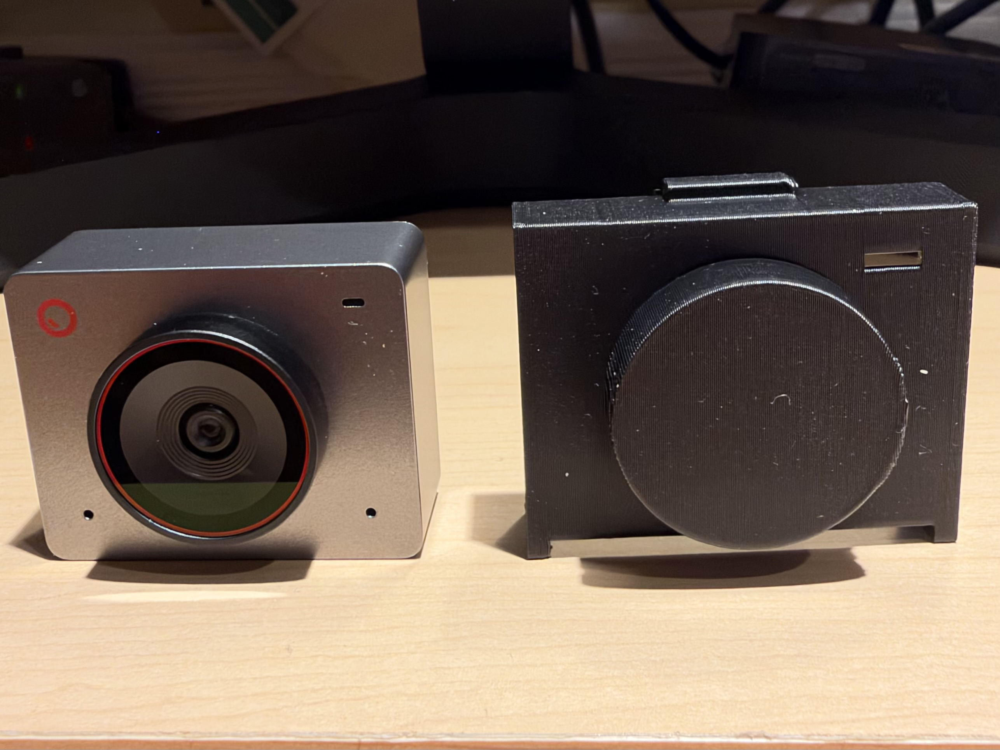
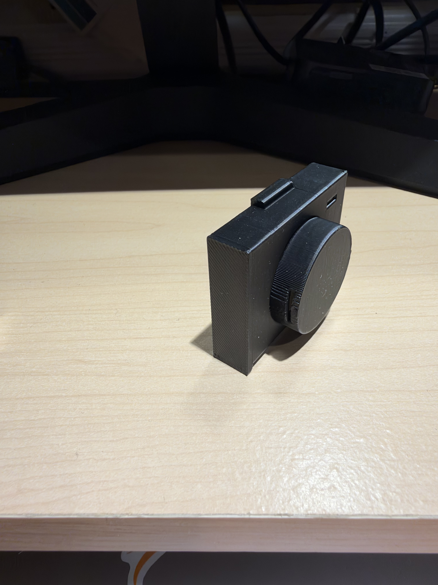
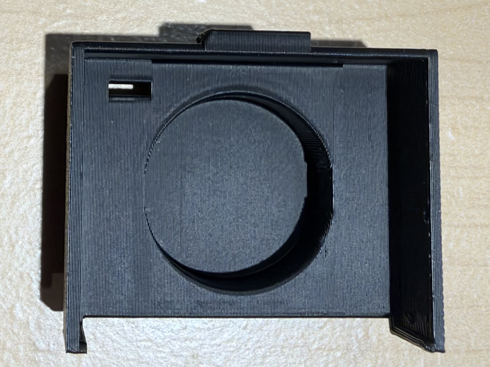
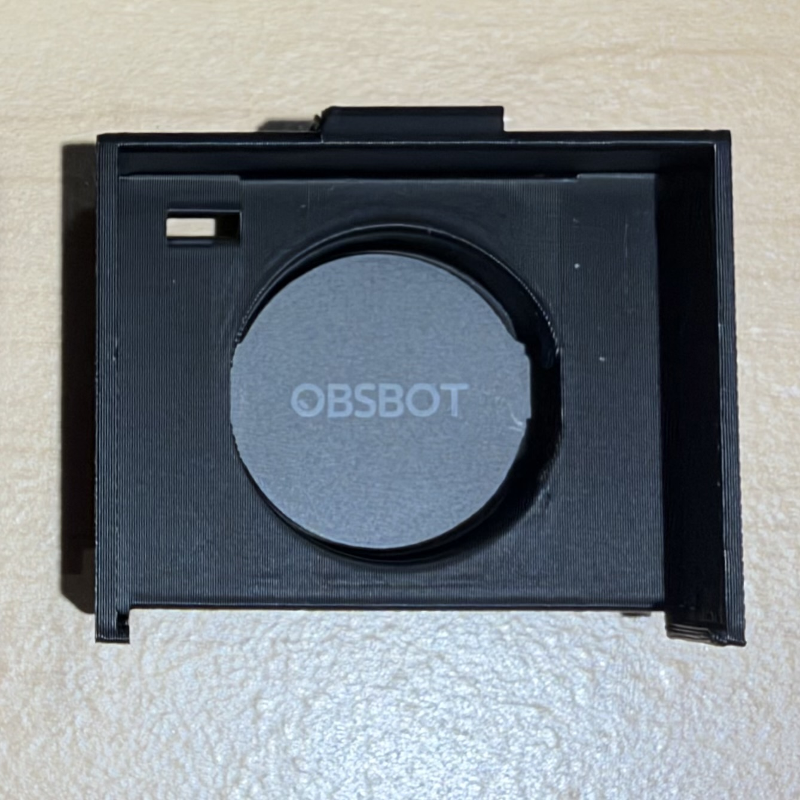
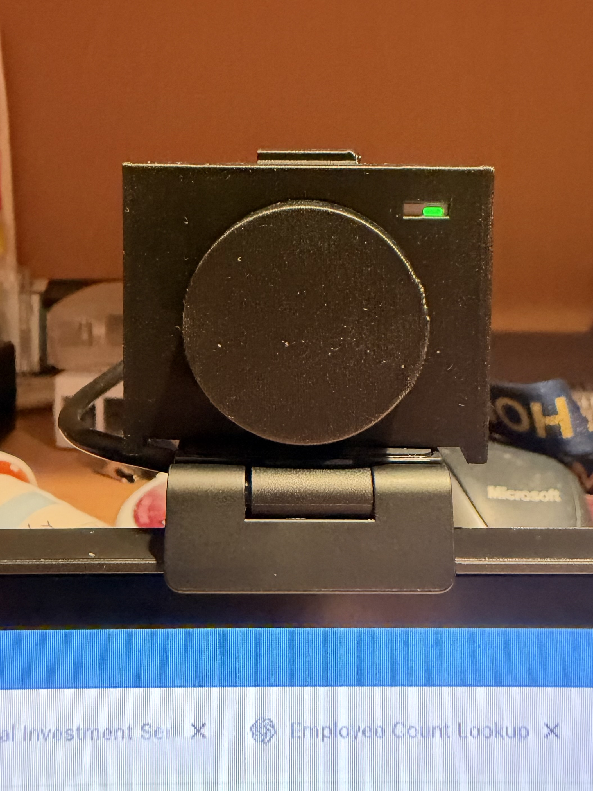

# Obsbot Meet 2 Magnetic Privacy Cover

A custom 3D-printable privacy cover designed specifically for the **Obsbot Meet 2** webcam. Unlike standard clip-on covers, this design provides comprehensive physical security by blanking out both the camera lens and the built-in microphones, while integrating a clever mounting solution using the original manufacturer-included magnetic disk.

---

## Visual Overview

| Front Comparison | Side Profile |
| :---: | :---: |
|  | |
| *Obsbot Meet 2 alongside the 3D-printed cover featuring the status LED cutout.* | *Side profile showing the low-profile fit and clean layer alignment.* |

 

| Interior Slot (Empty) | Interior (Magnet Fitted) | Mounted & Active |
| :---: | :---: | :---: |
|  |  |  |
| *Interior recess showing the slot for the magnetic mount].* | *Obsbot-branded magnetic disk seated securely inside the cover cavity.* | *Cover installed on camera while in use, keeping the LED indicator visible.* |

---

## Features

* **Complete Privacy Protection:** Covers the primary camera lens and both directional microphones simultaneously.
* **Integrated Magnetic Mount:** Built with precision slots and recessed cavities to securely house the Obsbot-included magnetic piece, ensuring a snap-on fit.
* **Status Light Visibility:** Thoughtfully engineered cutout window allows the camera's LED indicator status light to remain visible when active.
* **Friction-Fit Precision:** Contoured precisely to the dimensions of the Obsbot Meet 2 chassis.

---

## 3D Printing Recommendations

To achieve the best structural strength and clean tolerances for the magnet slot, use the following slicer settings:

* **Printer Type:** FDM (Cartesian or CoreXY)
* **Filament:** PLA, PETG, or ABS
* **Layer Height:** $0.2\,\text{mm}$ or finer
* **Perimeters/Walls:** 3 to 4 walls for added durability around the magnetic slots
* **Infill:** $20\% - 40\%$ (Grid or Gyroid)
* **Supports:** Generally **not required** if oriented flat on the print bed.
* `obsbot-meet-2-cover-v7.scad` file avaialable for additional editing

---

## Assembly & Installation

1. **Print the Model:** Export the `obsbot-meet-2-cover-v7.stl` file into your preferred slicer and print using the recommended settings above.
2. **Prepare the Magnet:** Take the original magnetic disk included with your Obsbot Meet 2 package.
3. **Insert the Magnet:** Align and press the magnetic component into the designated interior slot built into the printed cover. 
4. **Mount to Camera:** Slide or snap the cover onto the front face of your Obsbot Meet 2. The embedded magnet will secure it firmly to the camera frame.

---

## License

This project is open-source and released under the [MIT License](LICENSE). Feel free to modify, remix, and share improvements!
